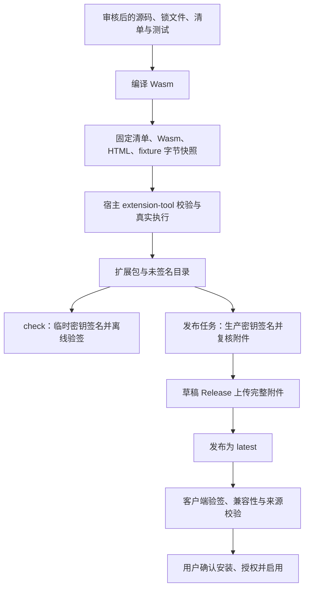

# 市场与插件架构

本仓库维护可审核的插件源码、收录清单和签名目录的构建发布流程。桌面宿主负责安装、授权、执行、界面和用户数据。两者独立发布，通过扩展包与签名市场目录连接；把本仓库作为宿主的子模块使用，不会让它成为应用的运行时依赖。

插件开发与验收从[文档索引](./README.md)和[开发指南](./development.md)进入。包、视图与 effect 的完整协议由宿主的[扩展指南](https://github.com/YanChao001/tauri-desktop-starter/blob/develop/docs/extensions.md)维护；修改协议时必须核对实际使用的宿主提交，不能只修改市场侧 JSON 检查来放行。

## 从源码到已安装插件

`check` 是本地与 PR 的验收路径，其临时签名只在内存中使用，不生成可发布的 `catalog.json`。它通过不代表线上目录已更新。生产签名由独立发布任务完成，签名任务不执行插件构建；草稿附件全部上传后才修改公开的 `latest`。

构建校验固定的是同一份输入字节：`host-tool.mjs` 有界读取清单、Wasm、清单引用的 UI 文档和 fixture，将快照交给宿主的 `validate` / `test`，打包使用已校验的清单、Wasm 和 UI 文档，避免校验后再次读取另一份模块。完整包哈希覆盖下载文件，模块哈希覆盖包中的 Wasm；两者用途不同。

客户端仍需验证签名、目录修订与有效期、附件大小及哈希、包清单和宿主兼容性。市场来源收据绑定仓库、公钥指纹、目录修订与完整包哈希，宿主安装时再次核对。有效签名说明目录来自相应密钥持有者、内容未被替换，不等于源码安全认证，也不授予系统权限。

## 语言与 Wasm

宿主接收符合 Extism ABI、导入 / 导出约束和资源限制的 Wasm 模块，不直接运行 `.js`、`.ts` 或 Rust 源文件，也不按这三种语言的文件后缀建立运行白名单。其他语言能否使用，取决于其工具链能否生成宿主实际接受的模块，并通过真实编译、调用和协议校验。

当前有两个需要区分的范围：

| 范围                       | 当前实现                                                                                              |
| -------------------------- | ----------------------------------------------------------------------------------------------------- |
| 本市场的四个插件与自动构建 | 全部使用 Rust + 官方 Extism PDK；构建脚本固定调用 Cargo，依赖 `Cargo.lock` 和 `build.json`            |
| 宿主仓库的开发示例         | 提供 Rust、JavaScript、TypeScript 示例；JS / TS 通过 Extism JS 工具链生成 Wasm                        |
| 非 Rust 插件在本市场收录   | 尚无对应自动构建入口，需要先评审固定工具链、依赖锁定和验收方案，不能直接加入现有 listing 并假设可构建 |

宿主示例位于[examples/extensions](https://github.com/YanChao001/tauri-desktop-starter/tree/develop/examples/extensions)。JS / TS 示例使用的是 Wasm 内的 PDK 环境，不能假定具有浏览器 DOM、Node.js 文件系统或 npm 包的全部运行能力。

## 插件界面与 HTML

界面与业务模块是两个执行上下文，可以按工作量选择：

| 路线       | 作者提供                                            | 适用范围                             |
| ---------- | --------------------------------------------------- | ------------------------------------ |
| 文本命令   | Wasm 导出返回文本                                   | 快捷转换与无交互工具                 |
| 通用视图   | Wasm 返回视图 JSON                                  | 标准表单、按钮、表格、图表与说明     |
| 自定义界面 | 上述视图 + 清单引用的单文件 HTML / CSS / JavaScript | 游戏、创作、画布与需要自由排版的应用 |

四款市场插件采用自定义界面：科学计算器组织键盘、表达式与曲线，贪吃蛇在 Canvas 运行本地游戏，信使组织联系人与消息，壁纸库组织图片与本机图库。它们都是自包含 HTML / CSS / JavaScript，不增加 React / Vite 构建依赖。其他作者也可使用框架生成的单文件结果，无需额外布局 DSL。Wasm 的 JS / TS 构建环境仍没有 DOM，与浏览器界面脚本不能混为一谈。

自定义 UI 在包内通过 uiDocuments 交付，由视图命令的 ui.document 指定文档 ID；源码位于 plugins/<directory>/ui/<id>.html。打包快照包含 HTML；目录预览记录文档 ID、字节数与哈希，签名覆盖完整包。开发步骤见 [自定义界面开发](./development.md#自定义界面开发)，协议、额度和桥类型由配套宿主 [扩展指南](https://github.com/YanChao001/tauri-desktop-starter/blob/feature/workflows-and-extensions/docs/extensions.md#自定义界面) 与 [SDK](https://github.com/YanChao001/tauri-desktop-starter/tree/feature/workflows-and-extensions/sdk) 维护。

插件决定正文布局，宿主注入状态、主题、语言、字体与减少动效设置，并提供可覆写的基础控件样式。打开独立窗口、界面重载和会话工具集中在“扩展工具”入口，菜单没有返回扩展中心操作；主窗口导航由宿主承担。独立窗口提供语言与主题入口，可跟随宿主语言。安装审阅后一次完成授权与启用，可选权限默认不勾选。

无同源权限的 sandbox、响应 CSP、文档启动限制和受控 MessagePort 共同建立 UI 边界。作者不能直接访问宿主 DOM、可用原生 IPC、系统凭据或任意路径，不能加载远程页面 / 脚本。通用网络和私有 KV 使用既有 Wasm effects；长连接与图库使用下面的固定原生服务。窗口、代次、租约与资源哈希在原生读取时复核。它不是额外的 OS 资源沙箱，仍需审核代码并分别验收真实 WebView。细节见 [安全规范](./security.md#执行隔离与数据能力)。

## Wasm、界面与原生服务

| 职责                   | 当前实例                                              | 生命周期                             |
| ---------------------- | ----------------------------------------------------- | ------------------------------------ |
| 有界计算与校验         | 计算器表达式 / 数值算法、贪吃蛇得分重放、信使文本导出 | 每次 Wasm 调用使用新实例             |
| 高频显示与交互         | Canvas 游戏步进、曲线拖动、表单与消息布局             | 当前隔离界面，检查点保留会话         |
| 私有 KV 或通用网络效果 | 计算器工作区、贪吃蛇纪录                              | 明确动作、授权及 effect 回执         |
| 固定桌面服务           | LAN 监听与聊天、必应图片搜索与现有应用图库            | 原生服务持有能力，逐次核验身份与授权 |

SDK 只暴露 `lan` 与 `wallpaper` 服务，不是任意服务注册或原生命令路由。两者分别要求 `messaging:lan` 与 `wallpapers:manage`；普通 HTTP 授权不能代替它们，新声明也不能让旧宿主自动具备实现。

LAN 长连接归属使用服务的原生窗口。切换路由或重建 iframe 不会停止已经开启的监听；最后一个相关原生窗口关闭、明确停止、撤权、替换或退出才回收连接，历史仍保留。导入会话不会自动监听、重连或发送，明文与身份边界见 [安全规范](./security.md#原生服务与外部来源)。

壁纸服务复用应用现有图库与设置 revision，不创建第二份背景偏好。默认搜索必应图片，不按许可筛选；原生保存绑定当前安装身份与窗口、带 TTL 的结果缓存，界面只传结果标识。必应缩略图和第三方 HTTPS 原图仍通过原生来源、DNS / SSRF、重定向和资源额度校验；旧 Commons page ID 操作保留兼容。下载原图进入系统另存流程；加入图库使用重绘压缩结果。设置应用背景不等于设置操作系统桌面壁纸。详细边界见 [壁纸库说明](../plugins/wallpaper-browser/README.md)。

## 运行与数据边界

Wasm 负责请求分派、计算、业务校验和视图状态。宿主在固定的无界面 worker 中执行模块，每轮使用新实例；进程内存与全局变量不能充当长期存储。宿主负责队列、超时、合作取消、worker 回收、输入输出和资源额度，清单声明不能绕过实际运行检查。

插件通过受控 effect 请求私有存储或声明的网络操作。宿主注入当轮授权和存储快照，核验后执行 effect，再以 `host-result` 和明确回执继续调用插件。插件不能自行伪造宿主授权，也不能因为结果接收失败就假定副作用没有发生。存储写入使用 revision 比较；冲突和已完成但响应省略等结果应保留草稿并说明状态，不自动重放写入。

| 数据或能力                      | 所有者与边界                                                                    |
| ------------------------------- | ------------------------------------------------------------------------------- |
| 插件源码、清单、锁文件、fixture | 市场仓库维护，经过 PR 审查；不含用户数据或生产私钥                              |
| `target/`、`dist/` 与待发布包   | 本机 / CI 生成，不提交；发布附件作为客户端下载来源                              |
| 已安装包、授权、安装代次和来源  | 桌面宿主管理；本开发目录不是用户安装目录                                        |
| 视图 `state`、表单与导入会话    | 插件会话输入，需重新验证；不自动等同可信数据或业务备份                          |
| 插件私有存储                    | 宿主按插件隔离并提供配额、原子写入和 revision；插件定义自身数据语义             |
| 用户文本与文件                  | 由用户显式提供并满足相应授权；文件标识不等于任意路径访问                        |
| 通用网络与凭据                  | 宿主核验声明和授权后请求；系统凭据由宿主保管并注入，不把密钥读回插件            |
| LAN 联系人与消息历史            | 独立原生服务按插件 ID 保存，不属于插件 KV；导航不停止连接，窗口生命周期控制回收 |
| 图库、应用背景与原图            | 复用现有图库和设置；原图另存须用户选位置，不向界面返回路径                      |
| 文件产物                        | 插件返回有界内容，由用户选择位置保存；插件不指定任意目标路径                    |

精确声明以各自 `extension.json` 为准。当前两款离线插件使用可选私有存储，信使使用 LAN 服务，壁纸库使用壁纸服务，均不开放任意文件系统或 Shell。浏览器中的服务替身不能代替桌面安装、真实网络、对话框及多窗口生命周期验收。

## 源码职责

| 文件                                                                                         | 维护职责                                                |
| -------------------------------------------------------------------------------------------- | ------------------------------------------------------- |
| [listings.json](../listings.json)                                                            | 收录目录、分类、推荐标记和目标仓库                      |
| [plugins/](../plugins/)                                                                      | 可审查的插件业务源码、独立依赖锁、清单与测试            |
| [scripts/build.mjs](../scripts/build.mjs)                                                    | 编译全部收录项、打包、哈希和未签名目录                  |
| [scripts/host-tool.mjs](../scripts/host-tool.mjs)                                            | 有界字节快照、宿主工具选择、真实 Wasm 验证与 smoke 执行 |
| [scripts/protocol.mjs](../scripts/protocol.mjs)                                              | 市场目录与签名前结构检查；不替代宿主 ABI 检查           |
| [scripts/check.mjs](../scripts/check.mjs)                                                    | 无生产私钥的离线签名回归                                |
| [scripts/sign-release.mjs](../scripts/sign-release.mjs)、[verify.mjs](../scripts/verify.mjs) | 对照审核清单签名、复核附件和目录                        |
| [scripts/publish.mjs](../scripts/publish.mjs)                                                | 绑定源提交、检查修订递增、草稿上传和 latest 切换        |
| [.github/actions/host-tool/action.yml](../.github/actions/host-tool/action.yml)              | 从指定宿主版本构建权威无界面工具                        |
| [.github/workflows/publish.yml](../.github/workflows/publish.yml)                            | 分开构建与生产签名发布任务                              |

宿主的 [extension_runtime.rs](https://github.com/YanChao001/tauri-desktop-starter/blob/develop/src-tauri/src/extension_runtime.rs) 维护 ABI 和资源约束，[extension_view.rs](https://github.com/YanChao001/tauri-desktop-starter/blob/develop/src-tauri/src/extension_view.rs) 维护视图校验，[extension_execution.rs](https://github.com/YanChao001/tauri-desktop-starter/blob/develop/src-tauri/src/extension_execution.rs) 管理效果往返，[extension-view.tsx](https://github.com/YanChao001/tauri-desktop-starter/blob/develop/src/features/extensions/extension-view.tsx) 负责通用控件渲染。原生服务入口与长期选择见宿主 [ADR 0013](https://github.com/YanChao001/tauri-desktop-starter/blob/feature/workflows-and-extensions/docs/adr/0013-extension-desktop-services.md)；发布验收必须使用已审核的确定提交，不能把文档分支链接作为版本证据。

## 兼容与演进

当前处于开发阶段，协议可以做明确的破坏性修改，不提供未实现的旧版本兼容层。包格式、API、视图、市场目录和用户注册表是不同边界；一个清单版本改对了，不代表其他层自动兼容。协议升级需先完成对应宿主校验，再更新市场源码、测试、产物和签名目录。

宿主拒绝不兼容、未来版本或损坏数据时保留原件；不通过删除用户目录“修复”。旧开发态存档仅按宿主明确支持的归档重建流程处理。市场回退内容也应使用更高目录修订号重新发布，不能重用旧修订号或把旧 Release 标为 latest 来绕过客户端的防回退检查。
