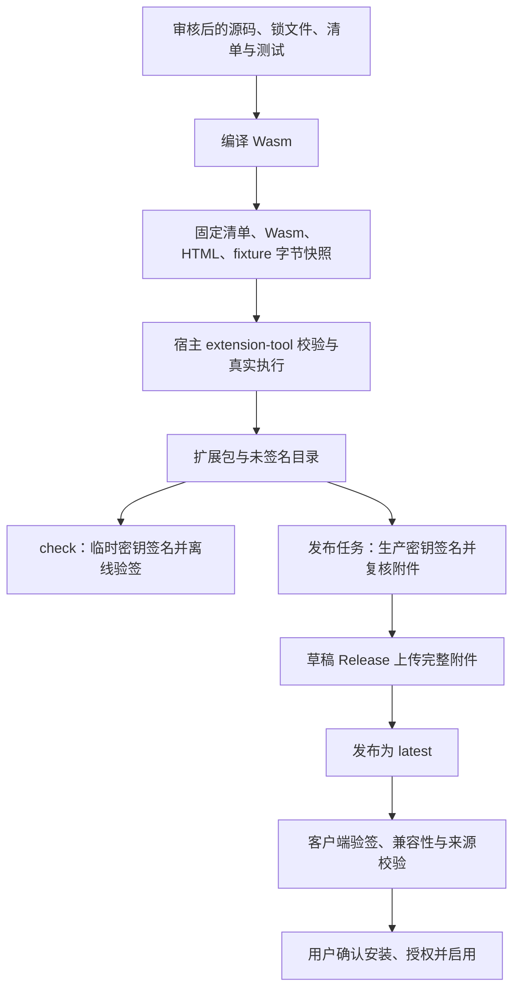

# 市场与插件架构

本仓库维护可审核的插件源码、收录清单和签名目录的构建发布流程。桌面宿主负责安装、授权、执行、界面和用户数据。两者独立发布，通过扩展包与签名市场目录连接；把本仓库作为宿主的子模块使用，不会让它成为应用的运行时依赖。

插件开发与验收从[文档索引](./README.md)和[开发指南](./development.md)进入。包、视图与 effect 的完整协议由宿主的[扩展指南](https://github.com/YanChao001/tauri-desktop-starter/blob/develop/docs/extensions.md)维护；修改协议时必须核对实际使用的宿主提交，不能只修改市场侧 JSON 检查来放行。

## 从源码到已安装插件

`check` 用一次性内存密钥做离线验收，不生成可发布的 `catalog.json`。生产签名由独立任务完成，草稿附件上传完整后才公开为 `latest`；步骤见 [发布指南](./publishing.md#actions-生产发布)。

`host-tool.mjs` 有界读取清单、Wasm、引用的 UI 文档和 fixture，将同一快照交给宿主 `test` 并打包。完整包哈希覆盖下载文件，模块哈希覆盖其中的 Wasm；校验范围见 [测试规范](./testing.md#真实-wasm-与手写-fixture)。

客户端独立核验目录、包、兼容性和安装来源；签名不代替源码审核或用户授权。完整信任要求见 [安全规范](./security.md#信任与职责)。

## 语言与 Wasm

宿主接收符合 Extism ABI、导入 / 导出约束和资源限制的 Wasm，不直接运行业务源文件。其他语言须先证明其工具链能生成可通过宿主静态与真实执行校验的模块。

当前有两个需要区分的范围：

| 范围                       | 当前实现                                                                                              |
| -------------------------- | ----------------------------------------------------------------------------------------------------- |
| 本市场的四个插件与自动构建 | 全部使用 Rust + 官方 Extism PDK；构建脚本固定调用 Cargo，依赖 `Cargo.lock` 和 `build.json`            |
| 宿主仓库的开发示例         | 提供 Rust、JavaScript、TypeScript 示例；JS / TS 通过 Extism JS 工具链生成 Wasm                        |
| 非 Rust 插件在本市场收录   | 尚无对应自动构建入口，需要先评审固定工具链、依赖锁定和验收方案，不能直接加入现有 listing 并假设可构建 |

宿主示例位于[examples/extensions](https://github.com/YanChao001/tauri-desktop-starter/tree/develop/examples/extensions)。JS / TS 示例使用的是 Wasm 内的 PDK 环境，不能假定具有浏览器 DOM、Node.js 文件系统或 npm 包的全部运行能力。

## 插件界面与 HTML

界面与业务模块是两个执行上下文，可以按工作量选择：

| 路线       | 作者提供                                            | 适用范围                             |
| ---------- | --------------------------------------------------- | ------------------------------------ |
| 文本命令   | Wasm 导出返回文本                                   | 快捷转换与无交互工具                 |
| 通用视图   | Wasm 返回视图 JSON                                  | 标准表单、按钮、表格、图表与说明     |
| 自定义界面 | 上述视图 + 清单引用的单文件 HTML / CSS / JavaScript | 游戏、创作、画布与需要自由排版的应用 |

四款市场插件均采用自包含 HTML / CSS / JavaScript，不增加 React / Vite 构建依赖；其他作者也可用框架生成单文件。界面脚本在浏览器中运行，与没有 DOM 的 Wasm JS / TS 环境分开。

自定义 UI 由包内 `uiDocuments` 交付，视图命令的 `ui.document` 引用文档 ID，源码位于 `plugins/<directory>/ui/<id>.html`。HTML 属于校验和签名快照；开发步骤见 [自定义界面开发](./development.md#自定义界面开发)，协议、额度与桥类型以配套宿主 [扩展指南](https://github.com/YanChao001/tauri-desktop-starter/blob/develop/docs/extensions.md#自定义界面) 和 [SDK](https://github.com/YanChao001/tauri-desktop-starter/tree/develop/sdk) 为准。

插件决定正文布局，宿主注入状态、主题、语言、字体、减少动效和可覆写控件样式。“扩展工具”提供独立窗口、重载与会话操作，主窗口导航由宿主承担；独立窗口另有语言与主题入口。

UI 通过无同源权限的 sandbox、CSP 和受控 MessagePort 与宿主隔离，不能直接取得宿主 DOM、原生 IPC、凭据或任意路径。这不提供额外的 OS 资源沙箱；细节见 [安全规范](./security.md#执行隔离与数据能力)。

## Wasm、界面与原生服务

| 职责                   | 当前实例                                                                  | 生命周期                             |
| ---------------------- | ------------------------------------------------------------------------- | ------------------------------------ |
| 有界计算与校验         | 计算器算法、贪吃蛇得分重放、聊天导出、图片 API / JSON / 筛选与结果校验    | 每次 Wasm 调用使用新实例             |
| 高频显示与交互         | Canvas 游戏步进、曲线拖动、表单与消息布局                                 | 当前隔离界面，检查点保留会话         |
| 私有 KV 或通用网络效果 | 计算器工作区、贪吃蛇纪录、壁纸图源 API 请求                               | 明确动作、授权及 effect 回执         |
| 固定桌面服务           | LAN 监听与聊天、短期图片资源、现有图库、公共 HTTPS 外链、插件自身窗口置顶 | 原生服务持有能力，逐次核验身份与授权 |

SDK 只暴露固定的 `lan`、`wallpaper`、`resources`、`links` 与 `window` 服务，逐次核验各自权限；`window` 只控制当前插件的独立原生窗口，完整契约由宿主维护。新增声明不能给旧宿主添加实现。调用入口见 [开发指南](./development.md#固定原生服务)，完整授权与网络边界见 [安全规范](./security.md#原生服务与外部来源)。

LAN 连接与历史由原生服务持有，界面导航或重建只结束自身轮询；文件选择与另存通过系统对话框。壁纸库的图源请求、解析及来源解释留在插件 Wasm，图片资源、图库与背景设置由宿主通用服务管理。用户操作见 [内网通信](../plugins/lan-chat/README.md) 和 [壁纸库](../plugins/wallpaper-browser/README.md)，授权、资源句柄和生命周期边界见 [安全规范](./security.md#原生服务与外部来源)。

## 运行与数据边界

Wasm 负责请求分派、计算、业务校验和视图状态。宿主在固定的无界面 worker 中执行模块，每轮使用新实例；进程内存与全局变量不能充当长期存储。宿主负责队列、超时、合作取消、worker 回收、输入输出和资源额度，清单声明不能绕过实际运行检查。

计算量较大的有界重放可选择宿主支持的执行预算，并声明准确最低宿主版本；预算不增加权限。取值与限额见配套宿主的 [执行与生命周期](https://github.com/YanChao001/tauri-desktop-starter/blob/develop/docs/extensions.md#执行存储与生命周期)。

插件通过受控 effect 请求私有存储或声明的网络操作。宿主注入当轮授权和存储快照，核验后执行 effect，再以 `host-result` 和明确回执继续调用插件。插件不能自行伪造宿主授权，也不能因为结果接收失败就假定副作用没有发生。存储写入使用 revision 比较；冲突和已完成但响应省略等结果应保留草稿并说明状态，不自动重放写入。

| 数据或能力                         | 所有者与边界                                                                        |
| ---------------------------------- | ----------------------------------------------------------------------------------- |
| 插件源码、清单、锁文件、fixture    | 市场仓库维护，经过 PR 审查；不含用户数据或生产私钥                                  |
| `target/`、`artifacts/` 与待发布包 | 本机 / CI 生成，不提交；发布附件作为客户端下载来源                                  |
| 已安装包、授权、安装代次和来源     | 桌面宿主管理；本开发目录不是用户安装目录                                            |
| 视图 `state`、表单与导入会话       | 插件会话输入，需重新验证；不自动等同可信数据或业务备份                              |
| 插件私有存储                       | 宿主按插件隔离并提供配额、原子写入和 revision；插件定义自身数据语义                 |
| 用户文本与文件                     | 由用户显式提供并满足相应授权；文件标识不等于任意路径访问                            |
| 通用网络与凭据                     | 宿主核验声明和授权后请求；系统凭据由宿主保管并注入，不把密钥读回插件                |
| LAN 联系人、历史与附件缓存         | 独立原生服务按插件 ID 有界保存，不属于插件 KV；导航不停止连接，窗口生命周期控制回收 |
| 远程图片与短期资源                 | 通用图片网络能力校验 HTTPS、网络与解码边界；资源绑定安装身份和窗口，关闭或撤权清理  |
| 图库、应用背景与原图               | 复用现有图库和设置；图库从资源压缩导入，原图另存须用户选位置，不向界面返回路径      |
| 文件产物                           | 插件返回有界内容，由用户选择位置保存；插件不指定任意目标路径                        |

精确权限以各自 `extension.json` 为准，用户用途见插件 README。浏览器服务替身不能代替桌面安装、网络、对话框及多窗口生命周期验收。

## 源码职责

| 文件                                                                                         | 维护职责                                                |
| -------------------------------------------------------------------------------------------- | ------------------------------------------------------- |
| [listings.json](../listings.json)                                                            | 收录目录、分类、推荐标记和目标仓库                      |
| [plugins/](../plugins/)                                                                      | 可审查的插件业务源码、独立依赖锁、清单与测试            |
| [scripts/build.mjs](../scripts/build.mjs)                                                    | 编译全部收录项、打包、哈希和未签名目录                  |
| [scripts/host-tool.mjs](../scripts/host-tool.mjs)                                            | 有界字节快照、宿主工具选择、真实 Wasm 验证与 smoke 执行 |
| [scripts/protocol.mjs](../scripts/protocol.mjs)                                              | 市场目录与签名前结构检查；不替代宿主 ABI 检查           |
| [scripts/check.mjs](../scripts/check.mjs)                                                    | 无生产私钥的离线签名回归                                |
| [scripts/sign-release.mjs](../scripts/sign-release.mjs)、[verify.mjs](../scripts/verify.mjs) | 对照审核清单签名、复核附件和目录                        |
| [scripts/publish.mjs](../scripts/publish.mjs)                                                | 绑定源提交、检查修订递增、草稿上传和 latest 切换        |
| [.github/actions/host-tool/action.yml](../.github/actions/host-tool/action.yml)              | 从指定宿主版本构建权威无界面工具                        |
| [.github/actions/plugin-check/action.yml](../.github/actions/plugin-check/action.yml)        | 使用市场工具链遍历收录项执行原生单测与 Clippy           |
| [.github/workflows/publish.yml](../.github/workflows/publish.yml)                            | 分开构建与生产签名发布任务                              |

宿主运行时、视图校验、效果执行与渲染的源码入口由 [宿主扩展指南](https://github.com/YanChao001/tauri-desktop-starter/blob/develop/docs/extensions.md) 维护。长期取舍见 [ADR 0013](https://github.com/YanChao001/tauri-desktop-starter/blob/develop/docs/adr/0013-extension-desktop-services.md)；发布使用的文档、SDK 与工具须对应 [固定宿主提交](./publishing.md#固定配套宿主)。

## 兼容与演进

当前处于开发阶段，协议可以做明确的破坏性修改，不承诺历史版本兼容，也不维护历史宿主矩阵。包格式、API、视图、市场目录和用户注册表是不同边界；一个清单版本改对了，不代表其他层自动兼容。协议升级需先完成选定当前宿主或固定待发布提交的校验，再更新市场源码、测试、产物和签名目录；未知或未来存档继续保留原件并拒写，不引入未经实现的迁移。

当前插件与宿主版本及跨仓库发布顺序统一见 [固定配套宿主](./publishing.md#固定配套宿主)。

支持未来条目隔离的宿主可在完整验签后显示不兼容条目的只读预览或摘要，仍拒绝下载与安装；签名、元数据、重复身份和防回退检查保持严格。适用版本及完整条件由 [宿主市场契约](https://github.com/YanChao001/tauri-desktop-starter/blob/develop/docs/extensions.md#官方插件市场) 维护，客户端症状见 [排障手册](./troubleshooting.md#某条目仅显示需要新宿主)。

宿主拒绝不兼容、未来版本或损坏数据时保留原件；不通过删除用户目录“修复”。旧开发态存档仅按宿主明确支持的归档重建流程处理。市场回退内容也应使用更高目录修订号重新发布，不能重用旧修订号或把旧 Release 标为 latest 来绕过客户端的防回退检查。
