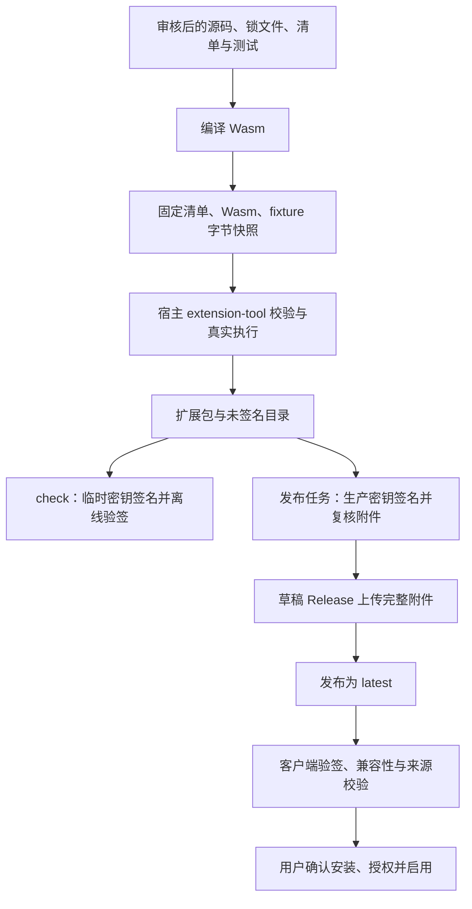

# 市场与插件架构

本仓库维护可审核的插件源码、收录清单和签名目录的构建发布流程。桌面宿主负责安装、授权、执行、界面和用户数据。两者独立发布，通过扩展包与签名市场目录连接；把本仓库作为宿主的子模块使用，不会让它成为应用的运行时依赖。

插件开发与验收从[文档索引](./README.md)和[开发指南](./development.md)进入。包、视图与 effect 的完整协议由宿主的[扩展指南](https://github.com/YanChao001/tauri-desktop-starter/blob/develop/docs/extensions.md)维护；修改协议时必须核对实际使用的宿主提交，不能只修改市场侧 JSON 检查来放行。

## 从源码到已安装插件



`check` 是本地与 PR 的验收路径，其临时签名只在内存中使用，不生成可发布的 `catalog.json`。它通过不代表线上目录已更新。生产签名由独立发布任务完成，签名任务不执行插件构建；草稿附件全部上传后才修改公开的 `latest`。

构建校验固定的是同一份输入字节：`host-tool.mjs` 有界读取清单、Wasm 和 fixture，将快照交给宿主的 `validate` / `test`，打包使用已校验的清单和 Wasm，避免校验后再次读取另一份模块。完整包哈希覆盖下载文件，模块哈希覆盖包中的 Wasm；两者用途不同。

客户端仍需验证签名、目录修订与有效期、附件大小及哈希、包清单和宿主兼容性。市场来源收据绑定仓库、公钥指纹、目录修订与完整包哈希，宿主安装时再次核对。有效签名说明目录来自相应密钥持有者、内容未被替换，不等于源码安全认证，也不授予系统权限。

## 语言与 Wasm

宿主接收符合 Extism ABI、导入 / 导出约束和资源限制的 Wasm 模块，不直接运行 `.js`、`.ts` 或 Rust 源文件，也不按这三种语言的文件后缀建立运行白名单。其他语言能否使用，取决于其工具链能否生成宿主实际接受的模块，并通过真实编译、调用和协议校验。

当前有两个需要区分的范围：

| 范围                       | 当前实现                                                                                              |
| -------------------------- | ----------------------------------------------------------------------------------------------------- |
| 本市场的四个插件与自动构建 | 全部使用 Rust + 官方 Extism PDK；构建脚本固定调用 Cargo，依赖 `Cargo.lock` 和 `build.json`            |
| 宿主仓库的开发示例         | 提供 Rust、JavaScript、TypeScript 示例；JS / TS 通过 Extism JS 工具链生成 Wasm                        |
| 非 Rust 插件在本市场收录   | 尚无对应自动构建入口，需要先评审固定工具链、依赖锁定和验收方案，不能直接加入现有 listing 并假设可构建 |

宿主示例位于[examples/extensions](https://github.com/YanChao001/tauri-desktop-starter/tree/develop/examples/extensions)。JS / TS 示例使用的是 Wasm 内的 PDK 环境，不能假定具有浏览器 DOM、Node.js 文件系统或 npm 包的全部运行能力。

## 插件界面与 HTML

交互插件返回声明式 JSON 视图，宿主校验后用自己的 React 组件创建 DOM、布局和交互控件。插件写业务规则和数据，宿主写 HTML / CSS 对应的渲染层。下面是一个视图 2 的简化、可独立解析的响应示例：

```json
{
  "version": 2,
  "state": "{}",
  "display": "问候工具",
  "description": "输入名称后生成问候。",
  "fields": [
    { "id": "name", "label": "名称", "value": "朋友", "kind": "text" }
  ],
  "groups": [
    {
      "columns": 1,
      "actions": [
        {
          "id": "greet",
          "label": "生成问候",
          "disabled": false,
          "primary": true
        }
      ]
    }
  ]
}
```

宿主将 `fields` 画成带标签的输入框，将 `groups.actions` 画成按钮。用户点击后，宿主把 `action: "greet"`、字段值、上一轮 `state` 和语言交给插件；插件计算并返回下一轮视图。名称里的 HTML 标签仍是文本，不会成为插件可执行的页面。普通文本命令声明 `resultFormat: "text"`，直接返回字符串，不需要视图 JSON。

现有视图可以组合表单、页签、按钮组、棋盘式按钮、Markdown、指标、分页表格、折线 / 柱状图、进度和受限图片，并生成让用户主动保存的文件产物。2048 和数织的棋盘使用声明式按钮，游戏规则与历史在 Wasm 中处理。

这种模式让主题、通用键盘操作、控件语义和权限入口由宿主统一实现。插件作者仍需提供清楚的标签、必要的 `ariaLabel`、中英文文案和可操作的窄屏布局，并验证实际交互。声明式协议不会自动保证所有插件都有良好的无障碍体验。

当前不支持插件提供任意 HTML / CSS / JavaScript 页面、自带 React 组件、DOM API、Canvas 脚本或自定义 WebView。图片产物与安全 Markdown 也不会开放这些执行能力。如果产品必须提供自由排版或复杂实时画布，需要单独设计新的界面能力、隔离和生命周期；这不是把一个 `index.html` 放进现有包就能启用的功能。

## 运行与数据边界

Wasm 负责请求分派、计算、业务校验和视图状态。宿主在固定的无界面 worker 中执行模块，每轮使用新实例；进程内存与全局变量不能充当长期存储。宿主负责队列、超时、合作取消、worker 回收、输入输出和资源额度，清单声明不能绕过实际运行检查。

插件通过受控 effect 请求私有存储或声明的网络操作。宿主注入当轮授权和存储快照，核验后执行 effect，再以 `host-result` 和明确回执继续调用插件。插件不能自行伪造宿主授权，也不能因为结果接收失败就假定副作用没有发生。存储写入使用 revision 比较；冲突和已完成但响应省略等结果应保留草稿并说明状态，不自动重放写入。

| 数据或能力                      | 所有者与边界                                                         |
| ------------------------------- | -------------------------------------------------------------------- |
| 插件源码、清单、锁文件、fixture | 市场仓库维护，经过 PR 审查；不含用户数据或生产私钥                   |
| `target/`、`dist/` 与待发布包   | 本机 / CI 生成，不提交；发布附件作为客户端下载来源                   |
| 已安装包、授权、安装代次和来源  | 桌面宿主管理；本开发目录不是用户安装目录                             |
| 视图 `state`、表单与导入会话    | 插件会话输入，需重新验证；不自动等同可信数据或业务备份               |
| 插件私有存储                    | 宿主按插件隔离并提供配额、原子写入和 revision；插件定义自身数据语义  |
| 用户文本与文件                  | 由用户显式提供并满足相应授权；文件标识不等于任意路径访问             |
| 网络与凭据                      | 宿主核验声明和授权后请求；系统凭据由宿主保管并注入，不把密钥读回插件 |
| 文件产物                        | 插件返回有界内容，由用户选择位置保存；插件不指定任意目标路径         |

当前市场插件只按需使用文本和私有存储，不请求网络、系统凭据或任意文件系统。精确声明以各自 `extension.json` 为准。浏览器演示不能代替桌面 Wasm 安装、worker 和系统能力验收。

## 源码职责

| 文件                                                                                         | 维护职责                                                |
| -------------------------------------------------------------------------------------------- | ------------------------------------------------------- |
| [listings.json](../listings.json)                                                            | 收录目录、分类、推荐标记和目标仓库                      |
| [plugins/](../plugins/)                                                                      | 可审查的插件业务源码、独立依赖锁、清单与测试            |
| [scripts/build.mjs](../scripts/build.mjs)                                                    | 编译全部收录项、打包、哈希和未签名目录                  |
| [scripts/host-tool.mjs](../scripts/host-tool.mjs)                                            | 有界字节快照、宿主工具选择、真实 Wasm 验证与 smoke 执行 |
| [scripts/protocol.mjs](../scripts/protocol.mjs)                                              | 市场目录与签名前结构检查；不替代宿主 ABI 检查           |
| [scripts/check.mjs](../scripts/check.mjs)                                                    | 无生产私钥的离线签名回归                                |
| [scripts/sign-release.mjs](../scripts/sign-release.mjs)、[verify.mjs](../scripts/verify.mjs) | 对照审核清单签名、复核附件和目录                        |
| [scripts/publish.mjs](../scripts/publish.mjs)                                                | 绑定源提交、检查修订递增、草稿上传和 latest 切换        |
| [.github/actions/host-tool/action.yml](../.github/actions/host-tool/action.yml)              | 从指定宿主版本构建权威无界面工具                        |
| [.github/workflows/publish.yml](../.github/workflows/publish.yml)                            | 分开构建与生产签名发布任务                              |

宿主的[extension_runtime.rs](https://github.com/YanChao001/tauri-desktop-starter/blob/develop/src-tauri/src/extension_runtime.rs)维护 ABI 和资源约束，[extension_view.rs](https://github.com/YanChao001/tauri-desktop-starter/blob/develop/src-tauri/src/extension_view.rs)维护视图校验，[extension_execution.rs](https://github.com/YanChao001/tauri-desktop-starter/blob/develop/src-tauri/src/extension_execution.rs)管理效果往返，[extension-view.tsx](https://github.com/YanChao001/tauri-desktop-starter/blob/develop/src/features/extensions/extension-view.tsx)负责实际控件渲染。跨仓库链接指向宿主集成分支供定位，发布验收必须使用已审核的确定提交。

## 兼容与演进

当前处于开发阶段，协议可以做明确的破坏性修改，不提供未实现的旧版本兼容层。包格式、API、视图、市场目录和用户注册表是不同边界；一个清单版本改对了，不代表其他层自动兼容。协议升级需先完成对应宿主校验，再更新市场源码、测试、产物和签名目录。

宿主拒绝不兼容、未来版本或损坏数据时保留原件；不通过删除用户目录“修复”。旧开发态存档仅按宿主明确支持的归档重建流程处理。市场回退内容也应使用更高目录修订号重新发布，不能重用旧修订号或把旧 Release 标为 latest 来绕过客户端的防回退检查。
